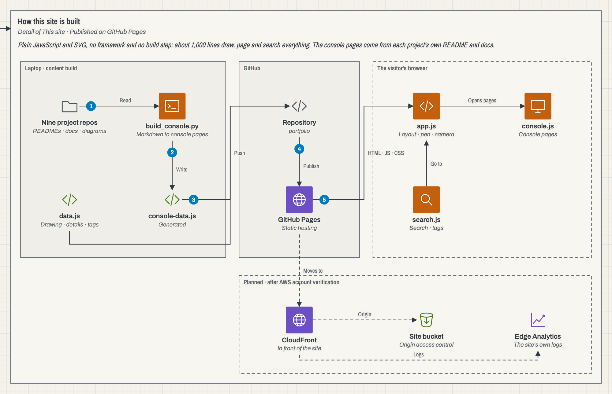

# Portfolio

[](https://github.com/tapiwa-magumise/portfolio/actions/workflows/ci.yml)

My portfolio, drawn as AWS architecture: [tapiwa-magumise.github.io/portfolio](https://tapiwa-magumise.github.io/portfolio/). Each area of my work is an account in an AWS Organization, and each project is drawn the way AWS reference diagrams are drawn, from that project's own Terraform, compose files and charts. Opening a project shows a console page built from its repository's README and docs.



## Status

Live on GitHub Pages, published by CI after the browser tests pass. The move to CloudFront in front of a private S3 bucket waits on AWS account verification; the Terraform for that is in the [first version's repository](https://github.com/tapiwa-magumise/prototype-portfolio).

## The problem it solves

A list of project cards says what someone built but not how the pieces fit, and a cloud engineer's work is mostly how the pieces fit. Here the visitor walks the architecture: each choice draws the next part of it, going back takes away the branch they left, and every part can be opened to see what it does in the project.

## How it works

1. `data.js` holds the whole drawing: the accounts, the projects, each project's detail with its boundaries, services and numbered flow, and each project's tags.
2. `scripts/build_console.py` reads each project repository's README and decisions record and writes `console-data.js`, so the console pages say what the repositories say.
3. `app.js` lays the tree out, draws it with a pen and moves the camera. `console.js` builds the console pages and `search.js` the search and tags.
4. `scripts/build_outline.mjs` runs the same page builders under Node and writes a plain text version of everything into `index.html`. That is what visitors without JavaScript, screen readers and search engines read.
5. CI checks the text version is current, runs the browser tests on a desktop and a phone profile, and only then publishes to GitHub Pages.

No framework and no build step: the files in the repository are the files that are served, about 1,000 lines of JavaScript.

## Testing

17 browser tests in Playwright, run on a desktop and a phone profile. They cover drawing and retracting branches, opening console pages and links straight to them, choosing a part from its Resources row, search and tags, blueprint mode and the system dark setting, the skip link to the text version, screen reader announcements, no sideways scrolling, thumb-sized controls on a phone, reduced motion, and the whole site with JavaScript switched off. Any script error fails a test.

## Running it

```
python3 -m http.server 8000      # then open http://localhost:8000
npm ci && npm test               # the browser tests
npm run outline                  # after changing data.js, console.js or console-data.js
python3 scripts/build_console.py # after a project's docs change
```

`build_console.py` expects the project repositories cloned side by side under `~/projects`.

## Repository layout

- `index.html`, `styles.css`, `console.css`: the page, the drawing's look and the console's look
- `app.js`, `console.js`, `search.js`: the drawing, the console pages, search
- `data.js`: the drawing's content; `console-data.js`: generated from the project repositories
- `assets/`: the CV and each project's architecture diagram
- `scripts/`: the console and text version generators
- `tests/`, `playwright.config.mjs`: the browser tests
- `docs/decisions.md`: the choices behind the site and what they cost
